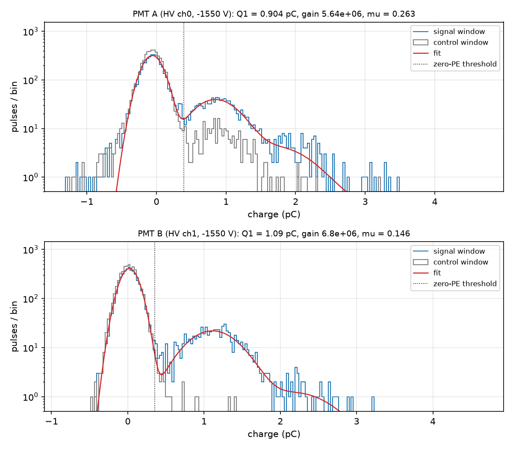
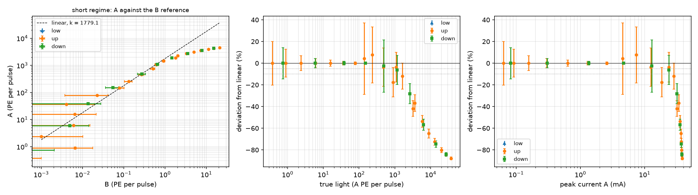
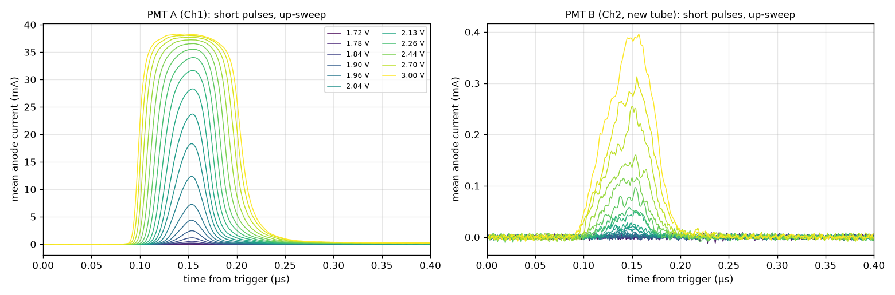
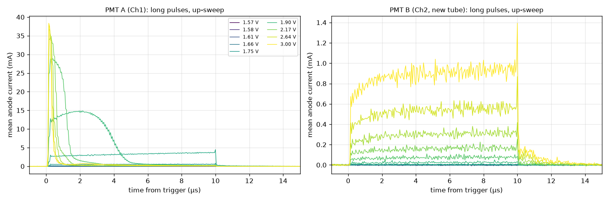
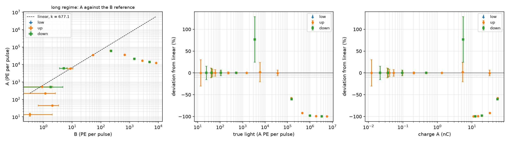

# PMT A saturation: short (100 ns) and long (10 µs) LED pulses, 2026-10-07 (evening)

This is the first full saturation characterisation of **PMT A** (ISEG ch0, −1550 V, Rigol Ch1). The reference is the
**new PMT B** (ISEG ch1, −1550 V, Rigol Ch2), which replaced the noisy original B and is the same tube type as A.
Everything ran unattended with `scripts/run_saturation_chain.sh`, and the HV was switched off at the end. The raw
frames are in `runs/saturation/` and `runs/spe/` (gitignored, local to the lab PC), with logs
`runs/saturation/chain.log`, `short_20261007_183537.log` and `long_20261007_183537.log`.

## SPE calibration (5000 pulses per PMT, 1 kHz)

| | PMT A | new PMT B |
|---|---|---|
| LED (AD3) for μ ≈ 0.15 | 1.703 V | 1.960 V ([B occupancy scan](occupancy_scan_B.png)) |
| **Q1** | **0.904 ± 0.013 pC** | **1.09 ± 0.014 pC** |
| Gain | 5.64 × 10⁶ | 6.8 × 10⁶ |
| Baseline noise | 1.2–2.5 mV rms | 1.4 mV rms (old B: 2.2 mV plus bursts) |

PMT A's Q1 is ~5 % below the morning value of 0.949 pC, a difference of about 2.5σ. The new B's SPE peak is well
separated from the pedestal, and its dark rate is far lower than A's.

## Method

- **LED pulses:**
  - **short:** 100 ns, 21 amplitudes from 1.72 to 3.00 V;
  - **long:** 10 µs, 16 amplitudes from 1.57 to 3.00 V.

  Both ran at **4 Hz** (below the 5 Hz base-recharge limit). The amplitudes went up the list, then came back down
  over every second point. There were 200 pulses per point for short pulses and 150 for long ones.
- Every point was auto-ranged; the peak guard (3 V) never tripped.
- **Burst frames are rejected** (none to 1 per point).
- Charges are integrated over 40–440 ns (short) or 0–14 µs (long), minus a same-width window before the light.
- **Light scale (user's prescription):**
  - Where B's mean is ≥ 0.05 PE and > 3σ, k × B is the true light, in units of A's photoelectrons.
  - At lower light, A is assumed linear.
  - k is fitted on the lowest-light points with a significant B, up to the first point that fails a linearity
    cut. That cut is A late/early ≥ 0.5 for long pulses, which keeps collapsed pulses out of the fit.
- **Deviation** = A / light − 1.

## Short pulses (100 ns): space-charge limit

- k = 1779 ± 198, from three points with B = 0.08–0.27 PE and A = 146–459 PE.
- **A is 5 % low at ~1,180 PE of true light per pulse (≈ 24.5 mA peak), and 10 % low at ~1,510 PE (≈ 27 mA).**
  The 11 % error on k carries into these numbers.
- **The peak anode current saturates at ~38 mA.** The pulse flat-tops and only gets longer. At 3.0 V, A delivers
  ~4,540 PE against ~37,000 PE of true light, i.e. 88 % low.
- **The down-sweep matches the up-sweep** within statistics (e.g. 2.85 V: 4,285 vs 4,283 PE), so there is no
  hysteresis or drift.

## Long pulses (10 µs): charge depletion

- k = 677 ± 30, from 1.746 V (A 5,940 PE) and 1.811 V (A 35,700 PE ≈ 32 nC).
  - This k is not the same as the short-pulse value (1779). B's 14 µs window also collects afterpulses and LED
    tails, and B's long-window charge is noisy; this is not yet understood.
  - B's charge per frame has ~30 PE of noise (the long record reads back at 50 ns spacing; see below). B is
    therefore only a useful reference above a few tens of PE.
- **A is linear (±5 %) up to at least ~36,000 PE of true light, i.e. about 32 nC delivered in 10 µs.** At this
  point its current is a flat 3–3.7 mA plateau.
- **The next point (1.898 V, ~150,000 PE of true light) is already 60 % low.**
  - A's current rises to ~15 mA and then **collapses after ~4 µs**: the base has run out of stored charge after
    delivering ~55 nC.
  - The interpolated 5 %/10 % crossings (~45k/55k PE) lie inside this gap. **A finer scan between 1.81 and
    1.90 V is needed** to locate the onset.
- **Brighter still** (2.0–3.0 V), A first hits its ~30–38 mA space-charge ceiling, then dies within 0.5–1 µs.
  Its **total charge falls** as the light rises (61k → 12k PE), while B rises from 665 to 8,280 PE.
- **The down-sweep reproduces the up-sweep**, even deep in depletion (2.64 V: 13,825 vs 13,832 PE).
- **The new PMT B shows no depletion up to ~9 nC per pulse.**
  - Its pulse shape (late/early 1.10–1.17) is the same at every intensity; the ~15 % rise through the pulse is the
    LED's own light profile (the Ch3 drive is flat).
  - The "B late/early moved" flag at 2.166 V is a 2 % shift and doesn't look like depletion.

## Caveats and next steps

- **Long-regime sampling:** frame-recorder replay must use `:WAV:MODE NORM`, which returns only the ~1000 screen
  points. The 50 µs long record is therefore sampled every 50 ns (20 MS/s).
  - A's envelope is fine at this spacing, but B can't be photon-counted.
  - For a better long-pulse reference, use a shorter screen window, or work out a different readout.
- **Light ratio:** k differs between the regimes (1779 vs 677); check B's long-window charge against afterpulsing.
- **Finer amplitude steps** are needed around the knees: 1.81–1.90 V (long) and 2.0–2.2 V (short).
- **Statistics on k:** more pulses at the 2–3 lowest B-significant points would tighten k, which sets the
  crossing points.
- **Same analysis for B:** the new B (same tube type as A) could be characterised the same way, but that needs a
  reference that gets more light than it does, i.e. swapping the roles.
