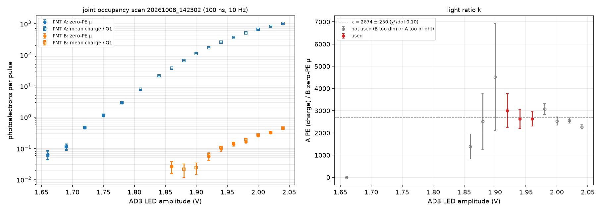
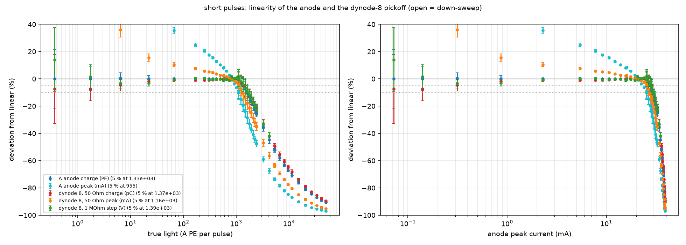
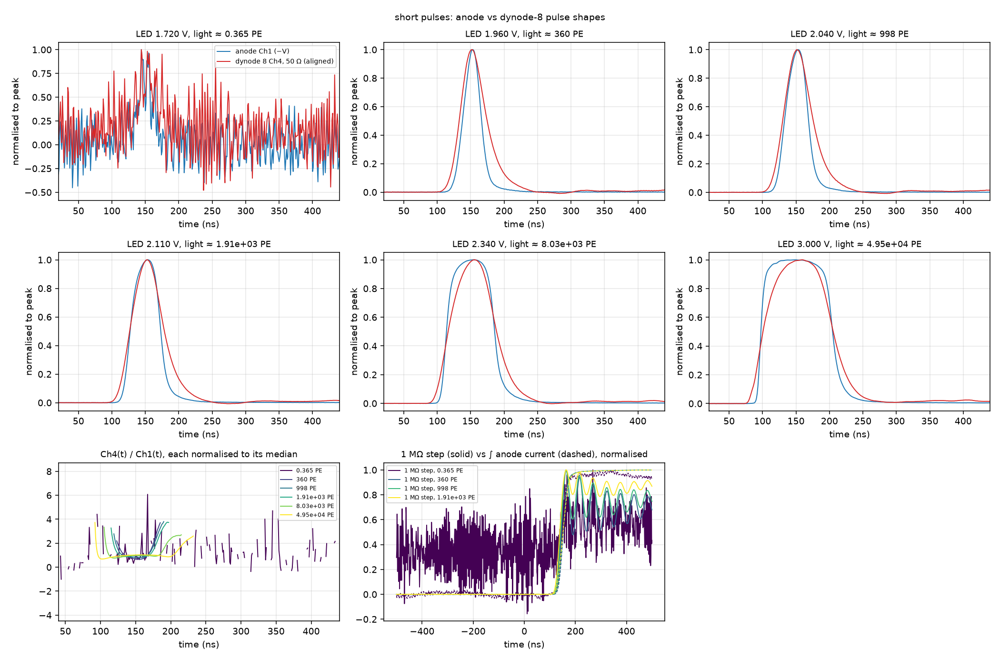
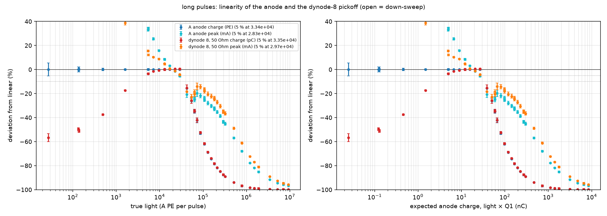
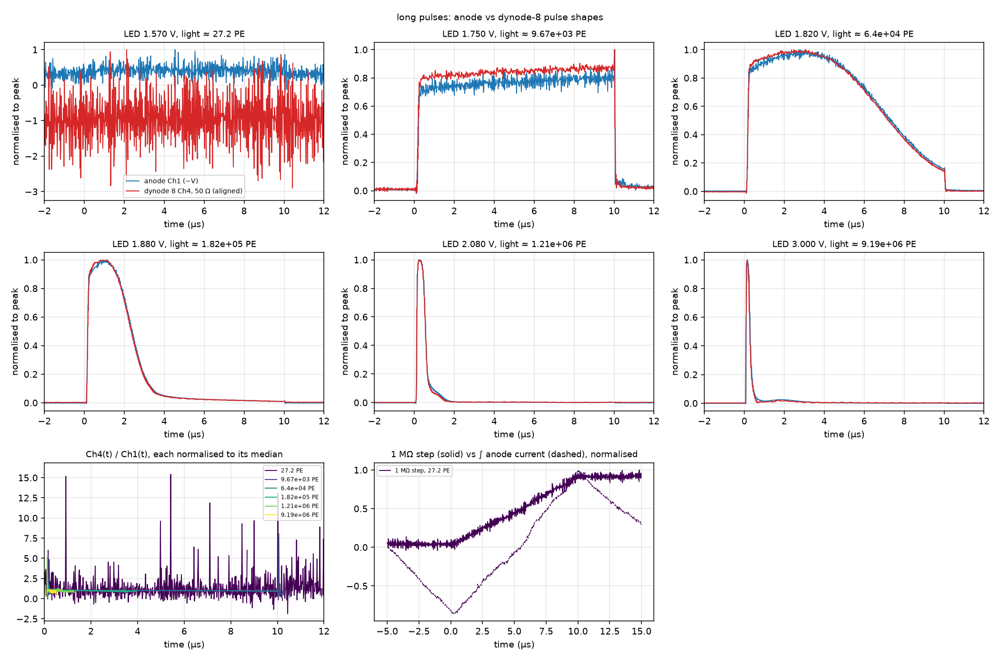

# PMT A saturation, round 2: anode and dynode-8 pickoff, 2026-10-08

This round re-measures PMT A (ISEG ch0, −1550 V) in both regimes. Compared with round 1
(`results/saturation_2026-10-07_newB/`) it adds:

- a joint occupancy scan to pin down the A/B light ratio;
- finer LED steps around both knees;
- **Ch4, PMT A's dynode 8 through a 4.7 nF pickoff**, recorded at 50 Ω and then at 1 MΩ at each LED point;
- long pulses sampled at 500 MS/s (round 1 was effectively at 20–50 MS/s).

The reference is PMT B (ISEG ch1, −1550 V, the new tube). The plan is in `NEXT_STEPS.md` and the code in
`saturation_r2.ipynb`, `ad3pulse/sat_analysis.py` and `ad3pulse/sat_plots.py`. The raw frames are in
`runs/saturation_r2/` (gitignored, lab PC):

| Files | Contents |
|---|---|
| `ratio_*` | ratio scan |
| `short_up/down*` | short-pulse scan |
| `long_up/down*` | long-pulse scan |
| `*1M_*` | the Ch4-at-1 MΩ recordings |

## SPE calibration and the light ratio

**SPE calibration (12:10):** A Q1 = **0.919 ± 0.011 pC** (gain 5.7 × 10⁶); B Q1 = **1.045 ± 0.019 pC** (6.5 × 10⁶).

**Joint occupancy scan** (100 ns pulses, 10 Hz, both PMTs at every point, auto-ranged):

- **A's charge/Q1 matches its zero-PE μ** to 1–3 % (0.115/0.113, 0.476/0.461, 1.147/1.142, 2.937/2.949). So the
  PE scale from Q1 is right.
- **B's charge/Q1 also matches B's μ** within errors (0.27/0.26, 0.32/0.32, 0.45/0.44).
- **k from the ratio scan** = A PE / B μ = **2674 ± 250**, from 1.92–1.96 V where B is significant and A is
  169–363 PE.

## How "true light" is defined (matched light scale)

- **B against LED voltage** is smoothed with a weighted spline in log space; the error band comes from a bootstrap.
- **k_match = A / B_fit** is fitted on points where B is well measured and A still linear. Short pulses use A in
  400–1000 PE: there dynode 8 tracks the anode within 1 %. Long pulses use 5000–30000 PE, before the
  depletion knee.
- **Below that window A itself is the light; above it, k_match × B_fit.** The scale is therefore continuous at
  the hand-over.
- **Each metric** (anode charge and peak; dynode 8 charge and peak at 50 Ω; dynode 8 step at 1 MΩ) is scaled to
  the light on the same window. So k cancels in the deviations.

| | k_match | cross-check |
|---|---|---|
| short (100 ns) | **2395 ± 58** | ratio scan 2674 ± 250 (1.1σ) |
| long (10 µs) | **1105 ± 19** | long dim-end fit 1049 ± 67 |

**The A:B light ratio is ~2.2× smaller for 10 µs pulses than for 100 ns pulses** (round 1: 677 against 1779). With
both PMTs linear, the light share can't depend on pulse length through the PMTs. It must be the LED: its
emission pattern or spectrum differs between the regimes, or changes with drive. The matched scale absorbs
this, but **B is not a drive-independent light reference across regimes**.

## Short pulses (100 ns): space charge

| Metric (short pulses) | 5 % low at (true light, A PE) | 10 % low at |
|---|---|---|
| A anode charge | **≈ 1330** | ≈ 1590 |
| A anode peak current | ≈ 955 | ≈ 1120 |
| dynode 8, 50 Ω charge | **≈ 1370** | ≈ 1650 |
| dynode 8, 50 Ω peak | ≈ 1160 | ≈ 1310 |
| dynode 8, 1 MΩ step | **≈ 1390** | ≈ 1650 |

The statistical uncertainty is roughly ±5–10 %, mostly from B and k_match.

**Anode:**
- Linear within ~1 % up to ~1000 PE, about 22 mA peak.
- 5 % low at ~1330 PE (≈ 1.2 nC). This is consistent with round 1 (1180/1510 PE for 5 %/10 %).
- The peak current flattens at **~39 mA**, and the pulse flat-tops (see the shapes below).

**Dynode 8:**
- **Barely more linear than the anode:** its 5 % point is only ~3–5 % higher, with essentially the same knee.
  The 50 Ω charge and the 1 MΩ step agree with each other to ~1 %.
- **Relative to the anode** (`short_ratio_diagnostic.png`): the anode falls behind dynode 8 smoothly. It is 1 %
  behind at ~900 PE, 2 % at ~1400 PE, **5 % at ~2300 PE (35 mA)** and 13 % at 4600 PE.
- **It carries ~70 % of the anode charge** (0.644 pC per anode PE), so it is a late, high-current stage. At the
  top end it falls far below the light too, about 90 % low at 3 V.

**Peak metrics** show an apparent *excess* at low light. This comes from the LED, not the PMT: at low drive it
emits a short spike, giving more peak per unit charge than at high drive, where the light fills the full 100 ns.
**The charge metrics are the reliable linearity measures.**

**Pulse shapes, Ch1 against Ch4:**
- Up to ~2000 PE the dynode-8 pulse is a slightly wider copy of the anode pulse.
- At 8000 and 50000 PE the **anode flat-tops** at its space-charge limit with sharp edges, while **dynode 8
  stays rounded**.
- The 1 MΩ trace is a clean charge step (with ~16 MHz ringing), proportional to the integral of the anode
  current.

Also in this folder: `short_vs_led.png` (pulse area and height against LED voltage, all channels),
`short_a_vs_b.png` (A against B and the B light curve), and `short_shape_metrics.png`.

## Long pulses (10 µs): charge depletion

| Metric (long pulses) | 5 % low at (true light, A PE) | 10 % low at |
|---|---|---|
| A anode charge | **≈ 33 400 (≈ 31 nC)** | ≈ 37 400 (≈ 34 nC) |
| dynode 8, 50 Ω charge | ≈ 33 500 | ≈ 37 600 |
| dynode 8, 1 MΩ step | no 1 MΩ data in range (stopped at 1.73 V; see below) | |

**Anode:**
- Linear to ~30 000 PE (≈ 28 nC per 10 µs pulse).
- The delivered charge **tops out at ~42 000 PE ≈ 38 nC** at LED 1.82–1.83 V. **Above that it falls** as the
  light rises (12 700 PE at 3 V), because the current collapses ever earlier in the pulse.
- The down-sweep reproduces the up-sweep to ≲1 %, even deep in depletion.

**Dynode 8 (50 Ω):**
- Saturates and collapses **at the same light level and with the same pulse shape as the anode**
  (`long_shapes.png`). So depletion is a whole-base effect.
- **For 10 µs pulses the 50 Ω pickoff is not a charge measure.** The 4.7 nF into 50 Ω is a 235 ns high-pass, so it
  largely follows the current. Its charge per anode PE drifts from 0.26 to 0.60 pC between 27 and 7000 PE, which
  is why its points sit low at small light.

**Dynode 8 (1 MΩ):** this is the proper charge measure, but it was stopped by the 3 V rule at 1.73 V. The forecast
there was 4.6 V. For long pulses it covers only A ≤ 1600 PE, well inside the linear range.

## Run notes (what went wrong, now fixed)

- **First chain attempt (12:10–13:05) failed.** A hardware script, `scripts/rigol_replay_test.py`, matched pytest's
  file pattern and opened a second scope connection during the run. That broke the session and left the scope's
  socket answering one reply late until it was power-cycled.
  - The script is now `scripts/rigol_replay_check.py`, guarded by `__main__`, and `pytest.ini` collects only
    `tests/`.
  - `RigolScope.connect()` drains stale replies.
- **The short scan's down-sweep crashed at 1.96 V** on a non-settling auto-range. A's peak sat at a V/div
  boundary. Fixed with hysteresis, and the auto-range no longer aborts a run. The long stage was then restarted by
  hand with the fix, followed by HV off.
- **Scope quirks found:**
  - only listed memory depths are accepted (`20k` is ignored), and only while running;
  - replay at full depth returns the same record for every frame, so NORM's 1000 points is the limit;
  - a `-0` offset is ignored;
  - a −6 V offset at 1 MΩ and 2 V/div was reported as applied but not applied.

  All are handled in code and recorded in `CLAUDE.md`.

## Next

- **A light reference independent of LED drive.** The regime-dependent k shows B's light share isn't constant.
  Options:
  - an ND filter on A, so both PMTs sit in the same light range;
  - a second LED, for the A + B = AB method;
  - photodiode monitoring.
- **Long pulses at 1 MΩ:** to see dynode 8's *charge* linearity through depletion, the 1 MΩ step needs
  attenuation (e.g. a capacitive divider) so it stays under 3 V.
- **Pulse-model fits** of the saved waveforms (the long window is −5 … +15 µs).
