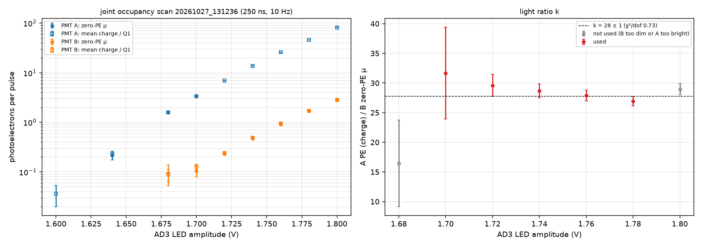
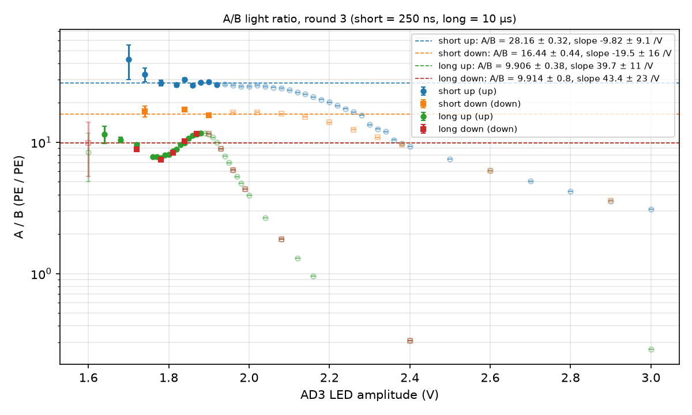
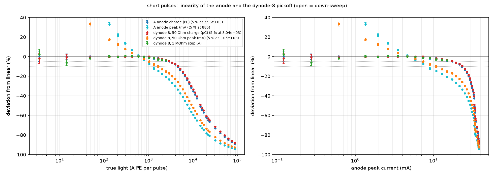
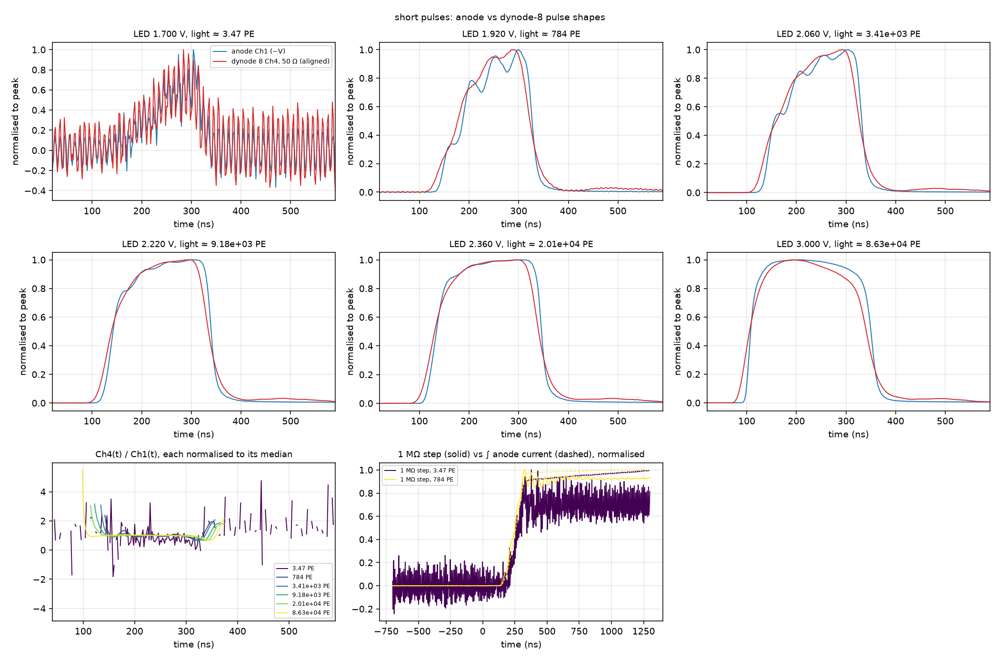
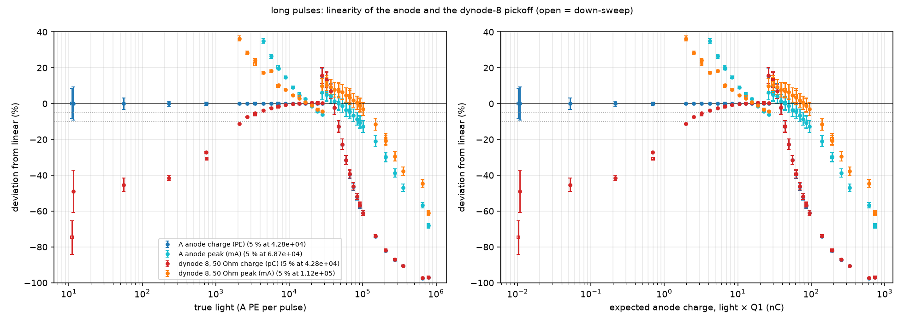
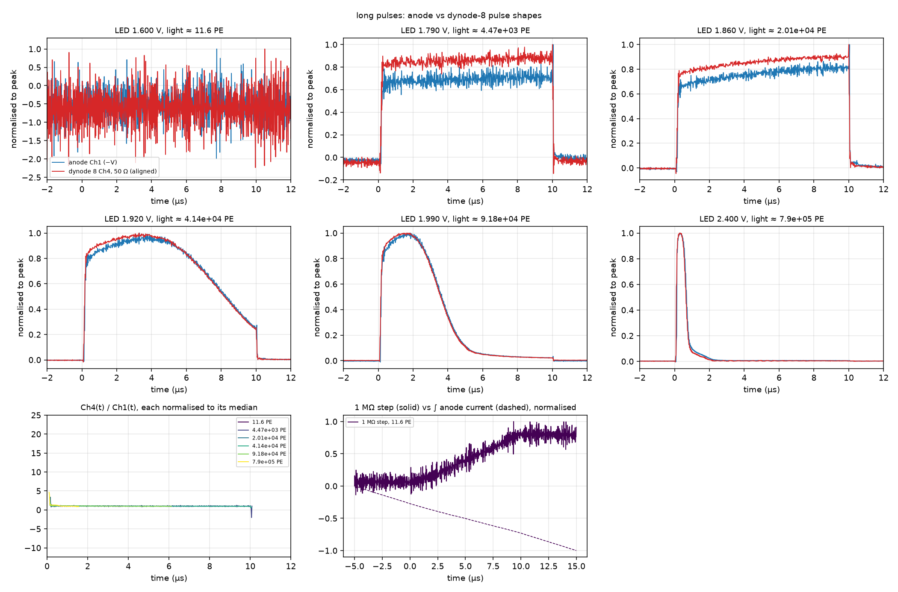

# Round 3: new light geometry, 250 ns short pulses, 2026-10-27

**Question:** after moving PMTs A and B to about the same position relative to the LED (and enlarging B's
attenuator hole), is the A:B light ratio k the same for short and long pulses, and flat across LED drive?
Round 2 (`results/saturation_r2_2026-10-08/`) had k = 2395 (100 ns) against 1105 (10 µs).

**Short answer:** no. B now gets far more light (k ≈ 28 short, ≈ 10 long, against ~2400 / ~1100), but
**the two regimes still differ by a factor ~2.5–3**, so the regime dependence is in the LED, not the
geometry. In addition, **the light split changed once during the run** (very likely a mechanical shift in the
new mounting), which limits which data can be combined.

Setup as in round 2: PMT A on ISEG ch0, B on ch1, both −1550 V / 50 µA, box dark; Ch4 = A's dynode 8
(4.7 nF pickoff) at 50 Ω and 1 MΩ. **Short pulses are now 250 ns** (`SHORT_WIDTH_S`): the AD3's 100 ns square
pulses are badly shaped. The SPE calibration still uses 100 ns pulses. Raw data: `runs/saturation_r3/`
(gitignored; run stamp `20261027_124902`, short scan `142422`, long scan `165916`), and the earlier reach passes
in `runs/saturation_r3/reach/`. Plots here come from `scripts/r3_writeup.py` (saved data only).

## Timeline

| Time | Stage |
|---|---|
| 10:53 | occupancy scan (SPE amplitudes) |
| 12:25 / 12:37 | reach passes, short and long |
| 12:49 | SPE calibration (5000 pulses each) |
| 13:12 | joint occupancy (ratio) scan, 250 ns, 10 Hz |
| 14:24 | short scan, up then down (39 + 13 points) |
| 16:59 | long scan, up then down |
| 18:52 | chain done, HV off (both channels < 2 V, status 0) |

## SPE calibration

- SPE amplitudes for μ = 0.15: A 1.738 V, B 1.836 V (round 2: 1.68 / 1.86; B gets more light now).
- **A: Q1 = 0.9353 ± 0.011 pC** (gain 5.84 × 10⁶); **B: Q1 = 1.089 ± 0.014 pC** (6.8 × 10⁶). Both within ~2–4 %
  of round 2.

## Light ratio k at low light

- **k = A PE / B μ = 27.8 ± 0.5** from 5 points (χ²/dof 0.73).
- **Threshold fix.** The zero-PE threshold was the pedestal median + 3·MAD σ. In the 400 ns window used for
  250 ns pulses that sat at 0.64–1.22 pC, i.e. at or above A's Q1, so a single PE often counted as "zero PE":
  charge/Q1 exceeded μ by 25–65 % for A, and k came out 29.5 ± 0.8 (χ² 2.5). The threshold is now fixed at
  **0.25·Q1** (`RATIO_THRESHOLD_Q1`). Charge/Q1 and μ then agree to 1–5 % for A (0.230/0.218, 1.576/1.581) and
  0–3 % for B (e.g. 0.954/0.921, 1.691/1.704).

## A/B against LED drive: the light split

Filled points have B significant and A in its linear range (`ab_ratio`, A below the top of
`MATCH_A_WINDOW` and before its maximum).

| | A/B (both linear) | points | χ²/dof |
|---|---|---|---|
| ratio scan, 250 ns, low light | 27.8 ± 0.5 | 5 | 0.7 |
| short, up-sweep (14:24–16:15) | **28.16 ± 0.32** | 9 | 2.0 |
| short, down-sweep (~16:15–17:00) | **16.44 ± 0.44** | 3 | 5.1 |
| long, up-sweep | 9.91 ± 0.38 | 16 | 750 |
| long, down-sweep | 9.91 ± 0.80 | 5 | 1200 |
| reach, short (12:25) | 28.6 ± 1.5 | 2 | |
| reach, long (12:37) | 14.1 ± 0.6 | 2 | |

**1. The light split changed once, during the short scan.** Between the up-sweep's linear part (done by
~15:20) and the down-sweep's dim end (~16:25 on), at the same LED voltage A dropped ~21 % and B rose ~28 %
(at 1.96 V), so A/B fell from 28 to 16.4. The long scan, two hours later, then sits at ~10 against 14 in the
12:37 reach pass: the same ~30–40 % drop. Before the change (reach → ratio scan → short up-sweep, 12:25–15:20)
and after it (long up → long down, 17:00–18:50) everything reproduces: the long down-sweep matches the
up-sweep to ≲1–3 % in A. A **one-off step** with stable data on both sides points to **something moving in the
mounting** (a tube, the attenuator or the LED), not to heating or gain drift: the duty cycle and anode currents
are tiny, and a gain change would not move A and B in opposite directions. To be fixed in hardware.

**2. The regime dependence remains.** In the reach passes (same mounting state, 12 minutes apart) long/short
= 14.1/28.6 ≈ 0.49; round 2 gave 1105/2395 ≈ 0.46. Equalising the geometry did not change it.

**3. For long pulses A/B depends on drive**, reproducibly between sweeps (hence the huge χ²): ~10–11 at
1.64–1.72 V, a dip to 7.8 at 1.76 V, then a rise to 11.8 at 1.88 V. Over 1.72–1.87 V **A's late/early ratio
rises from 1.00 to 1.14 while B's stays at 1.03–1.09**, so A's pulse grows late in the pulse before it depletes
(late/early drops below 1 from 1.90 V on). That looks like supralinearity of A, but it is only ~14 % in shape,
whereas A/B rises by ~50 % from the dip, and the dip itself is not explained; part of it is probably the LED's
light split changing with drive. This also shows up as the bump near 3 × 10⁴ PE in the long linearity plot
below.

## Short pulses (250 ns): space charge (up-sweep only)

The matched light scale uses the up-sweep only (before the shift): **k_match = 27.86 ± 0.19**, from A in
400–1000 PE, consistent with the ratio-scan k (27.8 ± 0.5) and the both-linear A/B (28.2 ± 0.3).

| Metric (250 ns) | 5 % low at (true light, A PE) | 10 % low at |
|---|---|---|
| A anode charge | **≈ 2960** | ≈ 4480 |
| A anode peak current | ≈ 885 (*) | ≈ 1190 |
| dynode 8, 50 Ω charge | **≈ 3040** | ≈ 4650 |
| dynode 8, 50 Ω peak | ≈ 1050 (*) | ≈ 1630 |
| dynode 8, 1 MΩ step | linear up to where it stops (skipped from 2.04 V, ≈ 3 V step) | |

(*) The peak metrics carry the LED-spike artefact seen in round 2 (excess at low light), so their knees are
not reliable; **the charge metrics are the linearity measures.**

- **The charge knee is ~2.2× higher in PE than at 100 ns** (round 2: 1330 / 1590 PE), roughly as expected if the
  limit is on peak current and the light is spread over 2.5× the time.
- **The peak current still flattens at ~38 mA** (round 2: ~39 mA): the space-charge limit is the same.
- **Dynode 8 is only ~3 % more linear than the anode**, as in round 2.
- The down-sweep (after the shift) is excluded; with both sweeps mixed, the chain's automatic analysis gave
  k_match 23.1 and a 5 % knee at 5640 PE, which is wrong. `scripts/r3_short_by_sweep.py` analyses the sweeps
  separately.

Also here: `short_vs_led.png`, `short_a_vs_b.png`.

## Long pulses (10 µs): depletion (treat with caution)

All long data were taken after the shift, and the two sweeps agree, so both are used:
**k_match = 10.2 ± 0.4** from A in 5000–30 000 PE (dim-end cross-check 9.8 ± 0.2).

| Metric (10 µs) | 5 % low at (true light, A PE) | 10 % low at |
|---|---|---|
| A anode charge | **≈ 42 800 (≈ 40 nC)** | ≈ 45 400 |
| dynode 8, 50 Ω charge | ≈ 42 800 | ≈ 45 400 |

- **Caveat:** the k_match window spans the drive-dependent A/B (point 3 above), so the scale is uncertain at the
  ~10–15 % level and the knee could be anywhere from round 2's ~33 400 PE to the value above.
- **A's delivered charge still tops out at ~38 nC** (~40 900 PE at 1.93 V), as in round 2 (~38 nC), then falls.
  That number does not depend on the light scale and is the robust result.
- Dynode 8 collapses with the anode (same shapes), as in round 2. The 50 Ω pickoff follows the current, not
  the charge, for 10 µs pulses (235 ns high-pass), hence its low points at small light.
- **PMT B holds far more charge than A:** B's charge reaches ~84 nC near 2.5 V before collapsing. But its
  late/early ratio rises steadily from 1.03–1.09 (≲ 3 nC, LED ≤ 1.89 V) to 1.16 at 5 nC (1.93 V), 1.28 at
  11 nC (2.0 V) and 1.44 at 22 nC (2.08 V), so for long pulses B is a clean reference only up to about
  1.9–2.0 V LED. The old note that "B has fewer base capacitors" was about the original B tube.

Also here: `long_vs_led.png`, `long_a_vs_b.png`, `summary.json` (k_match and all crossings).

## Code changes this round

- `SHORT_WIDTH_S` and `short_regime(width)` in `saturation_r2.ipynb`: record and analysis windows follow the
  short pulse width (250 ns default; pass `SHORT_WIDTH_S = 100e-9` to re-analyse round 2). `load_scan` refuses
  files recorded with a different width. The ratio cell no longer hard-codes 100 ns.
- `RATIO_THRESHOLD_Q1 = 0.25`: fixed zero-PE threshold for the ratio scan.
- `sat_analysis.ab_ratio()` and `sat_plots.plot_ab_ratio()` (A/B against LED with a drive slope), with a test.
- `run_r2_chain.sh` takes `OUT=<dir>`. New scripts: `ab_ratio_check.py`, `r3_short_by_sweep.py`, `r3_writeup.py`.

## Next

- **Make the mounting rigid** (tubes, attenuator, LED), then repeat the low-light ratio scan (~1 h) a few times,
  with a mechanical nudge in between, to see whether k = 27.8 returns and stays.
- The regime dependence (factor ~2) is now clearly an LED property. An independent light reference is still
  needed for an absolute linearity scale: an ND filter, a second LED (A + B = AB method), or a photodiode.
- For long pulses, find out whether the drive-dependent A/B is the LED or A: e.g. repeat with an ND filter on
  A so that A is far from depletion over the same drive range.
