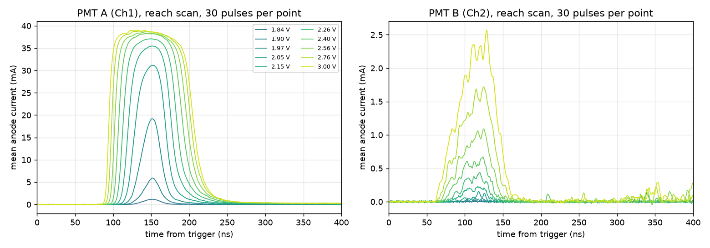
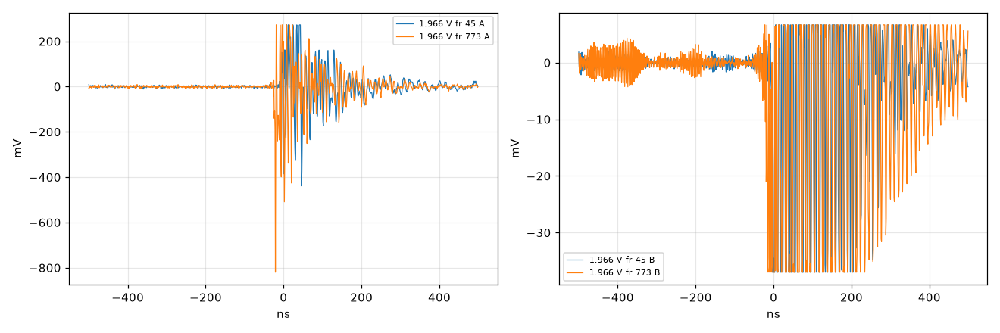
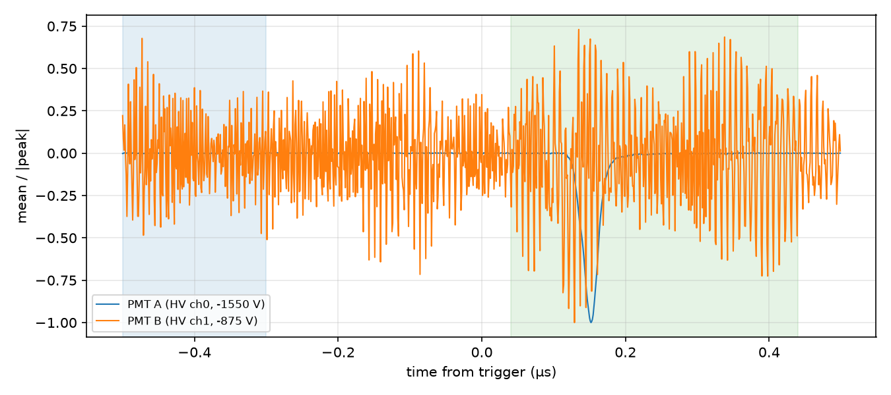

# Saturation, short (100 ns) LED pulses: first look, 2026-10-07

This is a first hardware pass of `saturation.ipynb` in the short regime (space-charge limit). PMT A (Ch1, ISEG ch0, −1550 V)
was the device under test and PMT B (Ch2, ISEG ch1, −875 V) the intended linear reference. The raw frames are in
`runs/saturation/` (gitignored, local to the lab PC):

- `short_timing_*`;
- `short_reach_*` (30 pulses per point, 2 Hz);
- `short_low_*` (1000 pulses per point, 10 Hz).

## Result: PMT A's peak anode current saturates at ~39 mA

| AD3 LED (V) | A charge (PE) | A peak (mA) | A FWHM (ns) | B charge (PE) |
|---|---|---|---|---|
| 1.841 | 35 | 1.3 | 26 | 0.4 |
| 1.898 | 171 | 6.0 | 24 | 0.6 |
| 1.966 | 646 | 19.2 | 29 | 2.3 |
| 2.048 | 1464 | 31.1 | 42 | 5.9 |
| 2.145 | 2211 | 35.5 | 57 | 15.9 |
| 2.261 | 2854 | 37.1 | 71 | 32.3 |
| 2.399 | 3449 | 38.3 | 83 | 60.6 |
| 2.565 | 3908 | 38.5 | 94 | 109.7 |
| 2.763 | 4289 | 38.8 | 103 | 191.7 |
| 3.000 | 4568 | 39.0 | 110 | 299.9 |

These come from the reach scan, so they are means of 30 pulses (`runs/saturation/reach_short.log`). Charge is integrated over 40–440 ns
and the peak is a 5-sample moving average. A's PE values use Q1 = 0.949 pC and B's use 0.492 pC.

- **A flattens at the top at 38–39 mA (≈ 1.9 V into 50 Ω).** As the light increases, the flat top only gets longer. A's
  charge goes up only ×3 from 2.05 to 3.0 V, while B's goes up ×50.
- **The flat top is not scope clipping.** The screen at 0.5 V/div spans −3.5…+0.5 V. Each frame has only one
  sample at its minimum ADC code, the plateau carries 28–49 mV of noise within a frame, and the peak keeps rising slowly. The
  same data also confirms the sign of the auto-range offset (positive `:CHAN:OFFS` moves the trace up).
- **The 2 V peak guard never tripped** (A's maximum was 1.96 V). The guard is now 3 V. The 50 Ω input is rated
  5 Vrms, with no transient overvoltage allowed (datasheet p. 11).

## Why there is no linearity curve yet

- **A gets ~250–400× more light than B.** While A is still linear (below ~20 mA, ~700 PE), B has at most a few PE.
  The user chose 1000 pulses per point at 10 Hz for the four lowest points:

  | AD3 LED (V) | A (PE) | B, net charge (PE) | B, zero-PE μ | A/B (charge) | A/B (μ) |
  |---|---|---|---|---|---|
  | 1.841 | 39.9 ± 0.2 | 0.09 ± 0.02 | 0.072 ± 0.011 | 429 ± 72 | 554 ± 82 |
  | 1.898 | 184.8 ± 0.6 | 0.85 ± 0.12 | 0.425 ± 0.024 | 217 ± 32 | 435 ± 25 |
  | 1.966 | 680.5 ± 1.4 | 2.29 ± 0.13 | 1.67 ± 0.07 | 297 ± 17 | 408 ± 16 |
  | 2.048 | 1502.4 ± 0.7 | 6.39 ± 0.10 | 4.50 ± 0.30 | 235 ± 4 | 334 ± 22 |

  Here B's window is 40–200 ns, with a same-width control window subtracted. The two B estimates disagree, and
  neither gives a constant A/B.
- **PMT B is too noisy:**
  - Its baseline carries ~2 mV rms of steady pickup, against the scope's 0.15 mV floor at 5 mV/div. B's SPE is only
    ~5 mV tall.
  - **Broadband ~100 MHz bursts** come every ~20–30 s. They hit both channels at ≈ −20 ns, before the light,
    ringing A by hundreds of mV and clipping B. Some of these frames were triggered by the burst itself, with
    odd Ch3 levels of 0.6 and 2.5 V against the ~1.9 V drive.
  - These 3–6 frames per 1000 dominate B's mean and produce a strong negative A–B correlation.

  
- **Decision (user):** swap PMT B for one with a better base. The HV was switched off for the swap.

## Next

1. Fit the new PMT B and choose its HV operating point (check its current), with the box confirmed dark.
2. Run a noise check: baseline rms, and whether the bursts persist. They also appeared on A, so they may be
   external.
3. Do an SPE calibration of the new B and update `Q1_PC[2]` in `saturation.ipynb`.
4. Reject burst frames in the analysis (pre-trigger excursions, abnormal Ch3 height) before taking means.
5. Re-run `timing` → `reach` → `lowlight` → `scan` in the short regime, then the long (10 µs) regime.

