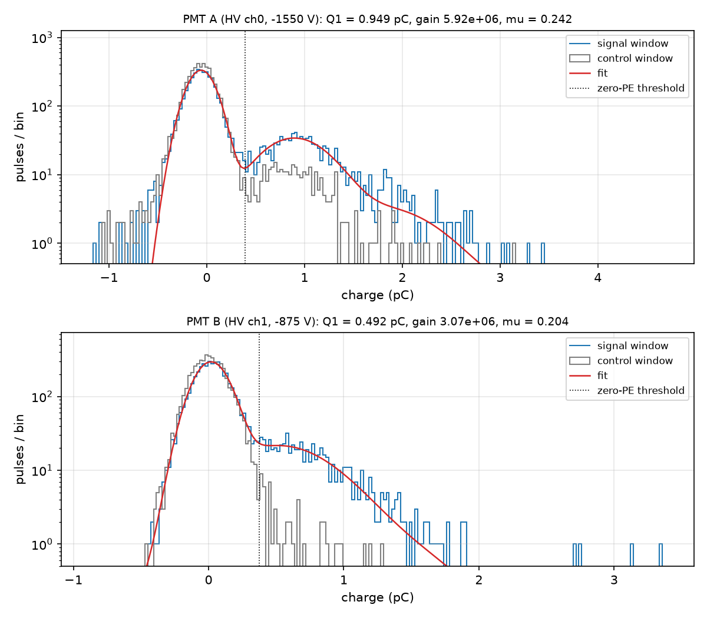
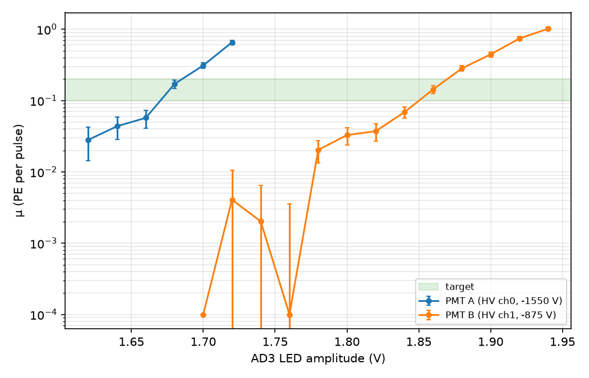
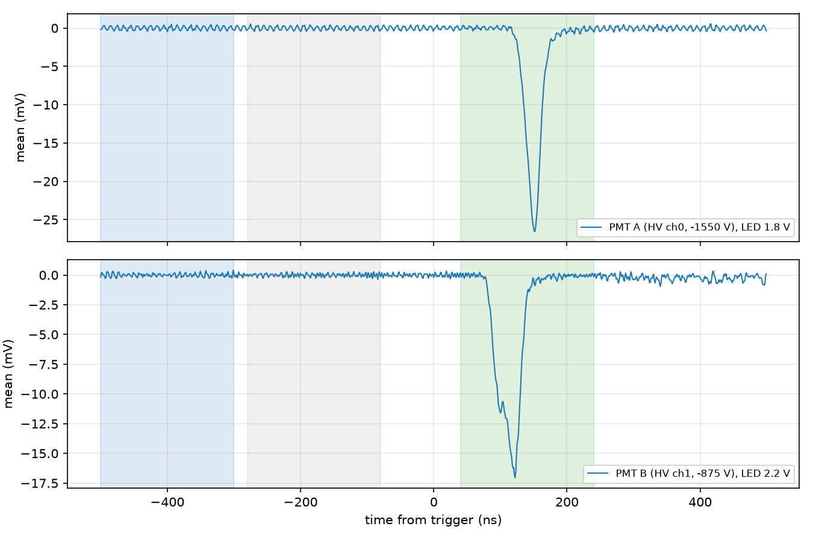

# SPE calibration, 2026-10-07

First single-photoelectron calibration of both PMTs with LED pulses, 5000 pulses per PMT.
Made with `spe_calibration.ipynb`. The raw frames are in `runs/spe/`, which is gitignored and local to the
lab PC. They can be re-fitted with `python scripts/run_spe_notebook.py refit`.

## Results

| | PMT A | PMT B |
|---|---|---|
| HV channel / voltage | ISEG ch0, −1550 V (16.9 µA) | ISEG ch1, −875 V (14.0 µA) |
| Rigol channel | Ch1 (50 Ω) | Ch2 (50 Ω) |
| LED amplitude (AD3 setting / measured on Ch3) | 1.6776 V / ~1.61 V | 1.8613 V / ~1.78 V |
| **SPE charge Q1** | **0.949 ± 0.014 pC** | **0.492 ± 0.034 pC** |
| **Gain (Q1 / e)** | **5.92 × 10⁶** | **3.07 × 10⁶** |
| SPE width σ1 | 0.298 pC | 0.318 pC |
| Pedestal width σ0 | 0.138 pC | 0.120 pC |
| μ, zero-PE count (dark-subtracted) | 0.172 | 0.135 |
| μ, from fit (includes dark pulses) | 0.242 | 0.204 |
| Dark pulses per 200 ns window | ~4–5 % (~200 kHz) | ~0.2 % (~10 kHz) |

## How it was measured

- **LED drive:**
  - The AD3 (W1) runs a free-running train of 100 ns pulses (104 ns realised) at 1 kHz into the LED, which has 330 Ω in series and turns on at ~1.6 V.
  - A tee sends a copy of the drive to Rigol Ch3, which is the trigger (rising edge, 0.5 V).
- **Capture:**
  - The Rigol waveform recorder captures every trigger: 1k points at 1 GS/s, −500…+500 ns around the trigger.
  - The frames are then read back one at a time in `NORM` mode.
- **Charge:** Q = −∫V dt / 50 Ω over three windows, all relative to the trigger:
  - **signal window:** 40–240 ns. The light arrives at ~130–180 ns on Ch1 and ~80–150 ns on Ch2.
  - **control window:** −280…−80 ns, the same width, where no LED light arrives.
  - **baseline:** −500…−300 ns, one median per run.
- **Occupancy:**
  - μ = −ln P0(signal) + ln P0(control), where P0 is the fraction of pulses below the pedestal median + 3σ.
  - The LED amplitude was interpolated for μ = 0.15, i.e. about one photon every 7 pulses.
- **Fit:** pedestal plus Poisson-weighted 1/2/3-PE Gaussians, with mean n·Q1 and variance σ0² + n·σ1² (`ad3pulse.spe.fit_spe`).

The occupancy scan used 500 pulses per point. Points drawn at μ = 10⁻⁴ are scan points where the measured μ
was ≤ 0 (no light above the dark rate). The LED output is very steep near turn-on, with μ roughly doubling
per 20 mV, and the low-μ end drifted between an evening and a morning scan. Re-check it before each
calibration run.

## Caveats / next steps

- **PMT B's SPE is only a shoulder:** Q1 is just 1.3× the zero-PE threshold. As a result:
  - its zero-PE μ is biased low (single photoelectrons below the threshold count as zero), which is why it is lower than the fitted μ;
  - Q1 has a 7 % uncertainty.
  - **Improvements:** a narrower Ch2 signal window (e.g. 60–180 ns, a re-analysis only), more pulses, or higher HV on PMT B.
- **PMT A's dark rate is high** (~200 kHz). This may be from recent light exposure.
- **The pedestal has a small negative tail** (~1 % below −3σ), probably baseline wander.
- 5000 pulses is a first look; the notebook is set up for 20k per PMT (~45 min each).
